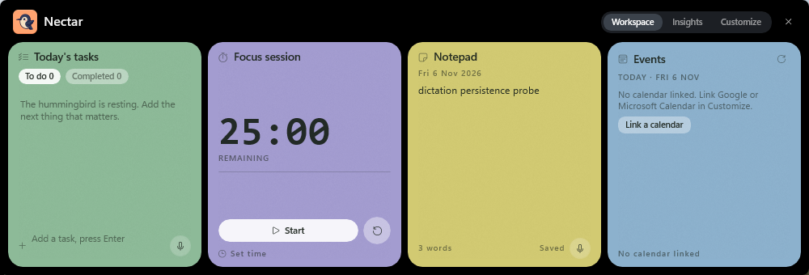
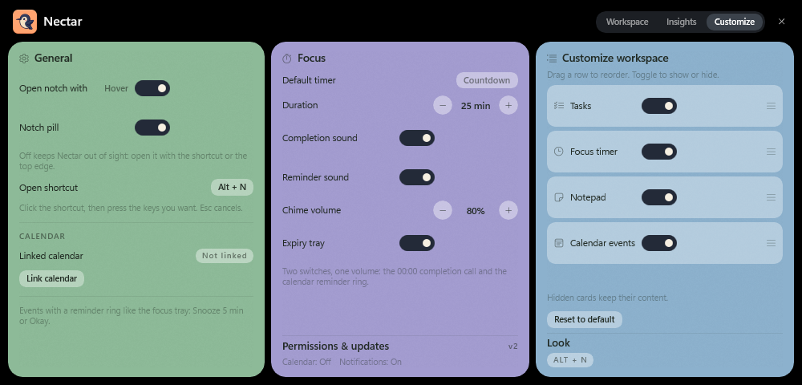
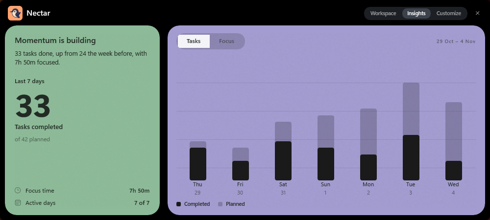
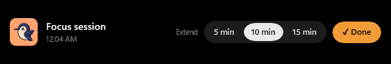
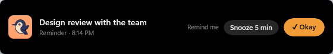

# Nectar

A native Windows productivity overlay that lives at the top edge of the screen. It ships as a
background agent with no primary window: hover the top-centre notch or press **Alt + N** and a
dark shell slides down holding four pastel cards — **Tasks**, **Focus timer**, **Notepad** and
**Events** — plus **Insights** and **Customize** views in the header. The open chord is rebindable,
and the Events card can show one linked calendar — Google or Microsoft — whose events can carry a
reminder tray of their own.

The mascot is the round navy bird from the logo — cream face, pink cheek, swept wing — on an
orange tile.
Built with C#, .NET 8, WinUI 3 and the Windows App SDK. No Electron, no MAUI, no web view.



## Local by design

Nectar runs entirely on the device: the workspace lives in an encrypted SQLite file under
`%LOCALAPPDATA%\Nectar`, and there is no account, no telemetry, no update service and no server.
The only network connections are the ones you start yourself by linking a calendar — Google
Calendar or Microsoft Graph, over their OAuth endpoints.

Releases are built and run locally; no cloud signing account is involved. Nectar ships as one
signed **MSIX** package, built and signed with **your own** certificate on your own machine. Local
packaging, signing and verification are in [`docs/SIGNING.md`](docs/SIGNING.md); the offline release
checklist is in [`docs/RELEASE-DRY-RUN.md`](docs/RELEASE-DRY-RUN.md).

## Website

The landing page, the install guide and the legal pages are one Next.js app in `web/` — nothing
else in the repository is served. `web/app/page.tsx` is the landing page (workspace tour, the three
ways in, calendar, customize, insights, local-first facts, install), `web/app/download-steps/page.tsx`
explains the Windows SmartScreen prompt before the download, and `web/app/privacy` +
`web/app/licence` are the legal pages, in the same header and footer as everything else.
`web/app/api/download/appinstaller/route.ts` builds the App Installer feed from the latest GitHub
release, so no signed MSIX is committed here.

```bash
cd web
npm install
npm run dev     # http://localhost:3000
npm run build   # static pages plus the feed route
npm test        # tsc + node --test
```

Production is <https://nectar-chi-eight.vercel.app>, deployed from the Vercel project `nectar`, whose
**Root Directory** is `web` — so a push to `main` deploys the site and there is no build step at the
repository root. `NECTAR_GITHUB_REPO=b4b6u/Nectar` is set for the `/download/windows` route and the
MSIX feed. Without a Root Directory of `web`, a Git-connected project builds the repository root and
fails. Security headers, the `/download` redirects and the `/privacy.html` → `/privacy` and
`/licence.html` → `/licence` redirects all live in `web/next.config.mjs`.

The canonical host lives in `web/app/layout.tsx` (`metadataBase`) and in `web/app/robots.ts` +
`web/app/sitemap.ts`. Change all three together when the domain changes — they generate the absolute
URLs that crawlers and link previews follow.

Screenshots in `web/public/docs/` are copies of `docs/*.png`; recopy them after re-shooting the app.
The favicon set, the PWA icons, `manifest.webmanifest` and `og-image.png` live in `web/public/` and
are generated from `docs/logo-source.png`. `docs/og-card.html` is the 1200 × 630 link-preview card;
re-render it after changing the copy, writing straight into the app:

```bash
msedge --headless=new --window-size=1200,630 --force-device-scale-factor=1 \
  --screenshot=web/public/og-image.png docs/og-card.html
```

---

## Setup installer and portable zip

```powershell
.\scripts\package-installer.ps1
```

Publishes the same self-contained build, compresses it to `dist\Nectar-<version>-win-x64.zip` and
compiles `dist\Nectar-Setup-<version>.exe` from `installer\nectar.nsi`. The setup installs per user
to `%LOCALAPPDATA%\Programs\Nectar`, with desktop and Start-menu shortcuts and an uninstaller — no
administrator rights and **no certificate to trust**, which is why it is the download offered to
people. `makensis.exe` is expected in `build\nsis\` (the portable NSIS zip) or on `PATH`; the
script accepts `-MakensisPath`.

The MSIX above remains the packaged build with App Installer updates, but it only installs where its
certificate is trusted (`docs/SIGNING.md`), so it is not the default download.

## Requirements

| Item | Version |
| --- | --- |
| Windows | 10 (19041) or later; 11 recommended for Mica |
| .NET SDK | 8.0 or later (`dotnet --version`) |
| Windows App SDK | shipped **self-contained** in the output, nothing to install |

## Build and run

```bash
dotnet build Nectar/Nectar.csproj -c Debug
Nectar/bin/Debug/net8.0-windows10.0.19041.0/win-x64/Nectar.exe
```

The app starts hidden. Bring it up with:

- **Alt + N** — toggle the workspace (change it in Customize → General)
- move the pointer to the **top-centre 240 x 6 px band** — hover expands it
- clicking the **pill** also expands it (the pill itself can be switched off)

## Packaging an MSIX

```powershell
.\scripts\package-msix.ps1
```

The script builds one **self-contained** package — the .NET runtime and the Windows App SDK travel
inside it, so the target machine needs nothing pre-installed — signs it with a local code-signing
certificate, checks the signature and prints the SHA-256. The result is
dist\Nectar-<version>-x64.msix.

```powershell
Add-AppxPackage -Path .\dist\Nectar-1.0.0-x64.msix
```

Windows lists Nectar in the Start menu, and the first launch drops **Nectar.lnk** on the desktop
pointing at the app's AUMID with the package icon. An MSIX cannot run an install script, so the
shortcut is created by the app itself. Remove the app with:

```powershell
Get-AppxPackage Nectar.Desktop | Remove-AppxPackage
```

An MSIX must be signed or Windows refuses to install it, so the script needs a certificate: it uses
`CN=Nectar` from `Cert:\CurrentUser\My` by default, or `-Thumbprint` / `-PfxPath`. A self-signed
certificate also has to be trusted machine-wide in `Cert:\LocalMachine\TrustedPeople` (one elevated
import, only for packages you build yourself). Certificate options and verification are in
[docs/SIGNING.md](docs/SIGNING.md). Never commit a `.pfx`.

## Publishing a loose folder

```powershell
dotnet publish Nectar/Nectar.csproj -p:PublishProfile=win-x64
.\scripts\sign-release.ps1 -PfxPath .\nectar-signing.pfx -Zip
```

The profile writes a **self-contained** folder to `Nectar/bin/publish/win-x64` for running without
installing anything — handy while developing. It is not the release artifact; the MSIX above is.

## Controls

| Action | Result |
| --- | --- |
| `Alt + N` | Show / collapse the workspace (rebindable in Customize → General) |
| Hover top-centre band | Expands (global low-level mouse hook); switchable off |
| "Snooze 5 min" / "✓ Okay" on a reminder tray | Re-arms the reminder five minutes later / dismisses it |
| `Esc` | Collapse back to the pill |
| Click a text field | The only time the window takes focus; type freely |
| `Enter` in "Add a task" | Creates the task in SQLite |
| `Ctrl + Enter` in Notepad | Promotes the caret's line into a task, removes it from the note |
| Ring on a task row | Toggle completion (persisted, re-sorted) |
| "Set time" | 15 / 25 / 45 / 50 minute focus sessions |
| Chevron (top right) | Collapse |
| Power (top right) | Flush the note and quit |
| Microphone (Tasks footer / Notepad footer) | Focuses that field and starts Windows Voice Typing (`Win`+`H`), so speech is transcribed straight into the input by the OS. Dictating again appends at the caret; pressing `Win`+`H` or the bar's stop button ends the session |

The note auto-saves 700 ms after typing stops, and is flushed synchronously on exit.

## Views

**Workspace** — the four cards, laid out in the order and visibility chosen in Customize.

**Insights** — two cards over the last seven days, compared with the seven before. The sage card
leads with the momentum headline and the hero count of tasks completed, then the focus time and
active-day footer. The lilac card is a native bar chart (no charting library): a Tasks/Focus pill
toggle, the window's date range, hairline grid lines, light "planned" caps behind near-black bars,
and the legend along the bottom. Both series come from SQLite — `Tasks.CompletedAt` and
`FocusSessions` — and are recomputed every time the tab opens.

**Customize** — three pastel cards. **General** (mint) holds how the notch opens: a **Hover** switch
for the top-centre band, a **Notch pill** switch (off hides the collapsed pill entirely, so Nectar
is reachable only by the shortcut or the top edge), and the editable **Open shortcut** (click it,
press the chord you want, Esc cancels), followed by the **Calendar** block. **Focus** (lilac) holds the default timer, session
duration, two independent sound switches — **Completion sound** (the bird call at 00:00) and
**Reminder sound** (a due calendar event) — chime volume (0–100% in 10% steps; 0% is silent for
both), the **Expiry tray** switch that decides whether 00:00 may drop the notification tray, and the
permissions/version footer. **Customize workspace** (sky) holds per-card visibility toggles,
drag-to-reorder and **Reset to default**, plus the Look tag line. All of it persists to
`settings.json`; reset restores the card layout and focus defaults but keeps the shortcut, hover
setting and calendar link. The header tabs sit top-right, matching the reference design.

**Focus expiry** — when the countdown reaches 00:00 the bird chime plays, unless **Completion
sound** is off, and the compact
`TimerExpiryTray` drops down only if the workspace is closed (folded to the pill or parked in the
background). It shows the hummingbird mark, the task the session was for, the time it finished, and
two actions: an **Extend** pill with three toggleable chips — **5 min**, **10 min**, **15 min** — where
the active one is the amount the last extend used (remembered in `settings.json`), plus **✓ Done**.
Clicking a chip adds that many minutes, resumes the countdown, and silences the chime; Done
completes that task, resets the countdown, and silences the chime. With the workspace open, or with
the Expiry tray switch off in Customize, nothing is shown or moved —the session simply ends on the timer card. The tray never gates the sound; the **Completion
sound** switch does.






### Calendar reminders

The Events card lists today's linked events, each with a bell. Ringing one asks when to be
reminded, then `ReminderScheduler` holds the time in
`%LOCALAPPDATA%\Nectar\reminders.json` and polls it every 15 s. A due reminder drops the *same*
tray as focus expiry — black 24-radius shell, no border, hummingbird mark, the event title and a
muted `Reminder · 8:15 PM` line — but with **Snooze 5 min**, which re-arms it five minutes later,
and **✓ Okay**, which dismisses it. Its ring is gated by **Reminder sound**, independently of the
focus chime, and the tray still appears when that switch is off. Reminders ignore the Expiry tray
switch and replace a focus tray that is already showing; afterwards the workspace returns to
whatever state it was in before.

### Focus chime

The expiry sound is Nectar's own asset rather than a system tone. Drop the file in and rebuild —
nothing else needs to change:

| | |
| --- | --- |
| Folder | `Nectar/Assets/` |
| File name | `bird-sound.wav` (preferred), or `bird-sound.mp3` / `bird-sound.m4a` |
| Format | WAV PCM 16-bit 44.1 kHz, mono or stereo, ~1–3 s; MP3 and M4A are also accepted |
| Build action | `Content` + *Copy to Output Directory* = `PreserveNewest` — already declared in `Nectar.csproj` for `Assets\*.wav`, `Assets\*.mp3` and `Assets\*.m4a` |

`Services/CompletionChime.cs` plays it with `Windows.Media.Playback.MediaPlayer`
(`AudioCategory = Alerts`, rewound to position 0 on every expiry) and is invoked from the focus
timer's `SessionCompleted` event, so it fires whether the workspace is open, collapsed to the pill,
or hidden. Until the file exists the app logs one hint and falls back to the system alert tone, so
the end of a session is never silent.

This is the only completion signal. `FocusTimerService` deliberately plays no tone of its own, so
00:00 can never produce two sounds; the **Completion sound** switch and the volume are the only
two things that silence it.

Calendar reminders reuse the same file and volume through a second switch, **Reminder sound**, so
the timer and the meeting alert can be muted independently.

## Architecture

```
Nectar/
├─ App.xaml(.cs)                  App lifecycle: single instance, hidden start, legacy data move
├─ MainWindow.xaml(.cs)           Overlay state machine (hidden → pill → workspace) + UI handlers
├─ Assets/                        Hummingbird brand assets (tiles, splash, ICO, header mark)
├─ Windows/
│  ├─ OverlayWindowController.cs  Presenter, chrome, taskbar/Alt-Tab, always-on-top, DWM polish
│  ├─ WindowGeometryService.cs    Top-centre anchoring in physical pixels, display/DPI changes
│  ├─ FocusGate.cs                WS_EX_NOACTIVATE ownership; explicit text-entry opt-in
│  └─ WindowMessageRouter.cs      SetWindowSubclass: WM_HOTKEY, WM_MOUSEACTIVATE, WM_DPICHANGED,
│                                 WM_DISPLAYCHANGE, WM_SETTINGCHANGE, Esc
├─ Interop/
│  ├─ NativeMethods.cs            Every user32/kernel32/comctl32/dwmapi entry point
│  ├─ DataProtection.cs           DPAPI protect/unprotect for the calendar tokens
│  └─ WindowStyle.cs              Verified Get/SetWindowLongPtr helpers
├─ Hooks/
│  ├─ GlobalHotKeyService.cs      RegisterHotKey for the open chord, re-registered on change
│  ├─ KeyboardCaptureService.cs   WH_KEYBOARD_LL chord capture, modifiers tracked per event
│  └─ PointerProbeService.cs      WH_MOUSE_LL on its own thread + message loop
├─ Data/
│  ├─ NectarDbContext.cs          EF Core + SQLite model (Tasks, Notes)
│  ├─ WorkspaceRepository.cs      Short-lived contexts per operation, error wrapping
│  └─ Entities/                   WorkspaceTask, EphemeralNote, FocusSession
├─ Settings/
│  └─ WorkspaceSettings.cs        Card order/visibility + focus defaults (settings.json)
├─ Services/
│  ├─ FocusTimerService.cs        Deadline-based countdown, PowerModeChanged pause, extend, no audio
│  ├─ CompletionChime.cs          The one completion signal: bird call at 00:00 (state-free)
│  ├─ ReminderScheduler.cs        Per-event reminders in reminders.json, 15 s poll, snooze
│  ├─ Calendar/
│  │  ├─ CalendarOAuth.cs         OAuth 2.0 + PKCE, loopback redirect, token refresh
│  │  ├─ OAuthLoopbackListener.cs Raw TcpListener on 127.0.0.1, no URL ACL needed
│  │  ├─ CalendarTokenStore.cs    DPAPI-encrypted token record (calendar-auth.bin)
│  │  └─ LinkedCalendarService.cs Google calendarView / Microsoft Graph, today only
│  └─ AppLogger.cs                %LOCALAPPDATA%\Nectar\nectar.log
├─ ViewModels/                    ObservableCollection state, TaskRow, CalendarEventRow, insights
└─ Styles/Theme.xaml              Shell, card palettes, typography, control styles
```

### Window behaviour (Win32 layer)

- `AppWindow.IsShownInSwitchers = false` + `WS_EX_TOOLWINDOW` → no taskbar entry, no Alt-Tab.
- `OverlappedPresenter.SetBorderAndTitleBar(false, false)`, not minimizable/maximizable/resizable.
- `IsAlwaysOnTop = true` **and** `SetWindowPos(HWND_TOPMOST)` — the presenter flag alone did not
  survive the first show, so the HWND is pinned explicitly on every show.
- `WS_EX_NOACTIVATE` is applied with `GetWindowLongPtr`/`SetWindowLongPtr`. `WM_MOUSEACTIVATE`
  returns `MA_NOACTIVATE`, so clicking cards, buttons and task rows never touches the foreground
  window. Clicking a text field is the one explicit opt-in: the window drops the style, calls
  `SetForegroundWindow`, and restores the style the moment it deactivates.
- Geometry: `X = workArea.X + (workArea.Width - width) / 2`, `Y = workArea.Y` in physical pixels,
  recomputed on `WM_DPICHANGED`, `WM_DISPLAYCHANGE` and `WM_SETTINGCHANGE`.

### Data

SQLite database at `%LOCALAPPDATA%\Nectar\nectar.db`, created on first run via
`Database.EnsureCreatedAsync()`. Schema changes are logged, never fatal — a broken database
surfaces a banner instead of killing the overlay. On the first launch after the rebrand, an
existing `%LOCALAPPDATA%\TopSpace` folder is moved to `%LOCALAPPDATA%\Nectar` and `canopy.db` /
`canopy.log` are renamed, so no tasks or notes are lost.

`WorkspaceTask` carries `Id`, `Title`, `IsCompleted`, `CreatedAt`, `Deadline?`.
`EphemeralNote` is a single row (fixed id) with `Content` and `LastEdited`.

Reminder times are the one piece of per-event state outside SQLite: `reminders.json` next to the
database keeps `{ id, title, fireAt, notified }` for every event that asked for one.

### Calendar

Nectar links **one** calendar at a time — Google Calendar or Microsoft Calendar — through OAuth 2.0
authorization code + PKCE. The General card takes a **Desktop app** OAuth client ID (plus the tenant
for Microsoft, `common` by default); **Connect** opens the browser and catches the redirect on a
loopback listener at `http://127.0.0.1:{port}/oauth`, so no URL ACL or elevation is needed. Access
and refresh tokens are encrypted with DPAPI for the current user in
`%LOCALAPPDATA%\Nectar\calendar-auth.bin` and never logged; the client ID and tenant live in
`settings.json`. Google is read through `calendarView` on `primary`, Microsoft through Graph
`me/calendarView`, both narrowed to today, and the access token refreshes itself when it expires.
Linking a second provider replaces the first, so the Events card always speaks for one calendar.
Nothing is fetched until a client ID is supplied — the link panel is the only place that asks for
one.

#### Registering a client

Nectar is a public client: PKCE only, no client secret. It listens on
`http://127.0.0.1:{port}/` with a fresh random port per attempt, and closes the listener as soon as
the code arrives.

| Provider | Console | Steps |
| --- | --- | --- |
| Google | Google Cloud console → APIs & Services → Credentials | Enable the **Google Calendar API**, create an **OAuth client ID → Desktop app**, paste the client ID. Desktop clients accept any loopback port, so no redirect URI has to be added. While the consent screen is in **Testing**, list your account under **Test users** (or publish the app). |
| Microsoft | Entra admin center → App registrations | Register an app, add the **Mobile and desktop applications** platform with `http://127.0.0.1` as a redirect URI, grant the delegated **Calendars.Read** permission, and paste the Application (client) ID. The portal refuses an `http` loopback that includes a port; add `http://127.0.0.1` through the app registration manifest instead — Entra then ignores the port. The tenant box takes `common`, a tenant id or a domain. |

The client ID and tenant are the only calendar values in `settings.json`; tokens stay in the
DPAPI blob.

## Brand assets

All icons derive from a single 2048 px master (`docs/logo-source.png`) and live in
`Nectar/Assets`. The generator crops the orange tile out of the master and keys the surround with
an anti-aliased rounded mask, so the artwork itself is never redrawn. Replace the master and rerun
the generator to refresh every size. Assets are copied next to the executable, so
`ms-appx:///Assets/nectar-mark.png` resolves in the unpackaged build too.

| File | Size (px) | Used by |
| --- | --- | --- |
| `nectar-mark.png` (+ `.scale-100/200/400`) | 96 / 192 / 384 | pill (20 px) and expanded header (30 px) `<Image>` |
| `Square44x44Logo.png` (+ `.scale-100/200/400`) | 44 / 88 / 176 | manifest `Square44x44Logo` |
| `Square44x44Logo.targetsize-{16,24,32,48,256}` (+ `_altform-unplated`) | 16–256 | taskbar / shell, transparent bird |
| `Square150x150Logo.png` (+ `.scale-100/200/400`) | 150 / 300 / 600 | manifest `Square150x150Logo` |
| `Wide310x150Logo.png` (+ `.scale-100/200/400`) | 310x150, 620x300, 1240x600 | manifest `Wide310x150Logo` |
| `StoreLogo.png` (+ `.scale-100/200/400`) | 50 / 100 / 200 | manifest `Logo` |
| `SplashScreen.png` (+ `.scale-100/200/400`) | 620x300, 1240x600, 2480x1200 | manifest `SplashScreen` |
| `LockScreenLogo.scale-100/200/400` | 24 / 48 / 96 | manifest lock screen |
| `nectar.ico` | 16, 24, 32, 48, 64, 128, 256 | `ApplicationIcon` (exe, Task Manager, Explorer) |
| `nectar-tray.ico` | 16, 20, 24, 32, 48 | reserved for a shell/tray icon |

Nectar itself has no notification-area icon: it is reachable through **Alt + N** and the hover
band. `nectar-tray.ico` exists so that adding `Shell_NotifyIcon` later needs no new artwork — point
`NOTIFYICONDATA.hIcon` at it.

## Design

Dark glass shell, four muted pastel cards, one accent: the notch is the object, the cards are
paper. Cards are laid out horizontally so the whole workspace fits in a 1000 x 340 DIP strip that
never covers the app you are working in. Cards and the shell carry no borders — only the pastel
fill, a rounded corner and a fine grain overlay (`Assets/card-grain.png`) for a matte finish.

| Card | Fill |
| --- | --- |
| Tasks | `#8DBA98` mint |
| Focus timer | `#A39CD0` lilac |
| Notepad | `#D2CA72` butter |
| Events / Customize workspace / Today's shape | `#8CB1CD` sky |
| Insights chart | `#A39CD0` lilac |

- Tasks: chips for open/completed, single-line rows with ring checkbox and dashed `2,2` dividers.
- Focus timer: headline shows the task you are focusing on; the countdown uses Consolas bold with
  wide tracking as the stand-in for a dot-matrix face until a `.ttf` is bundled.
- Notepad: word count and save state, dictation in the footer.
- Events: today's agenda; every row carries a reminder bell, and an unlinked calendar shows the
  link empty state.
- Insights: sage momentum card beside a lilac chart card with near-black activity bars over light
  planned caps.
- Customize: three cards — mint General, lilac Focus, sky workspace — with near-black toggle
  switches and sky-blue input fields.

Expansion animates `WorkspaceSurface.Height` 0 → 340 and its opacity with WinUI storyboards
(`DoubleAnimation`, `EnableDependentAnimation` for height); collapse runs the reverse and only
then shrinks the window back to a 200 x 30 pill.

## Troubleshooting

- **Log file**: `%LOCALAPPDATA%\Nectar\nectar.log`
- **Alt+N does nothing**: another app may own the gesture — rebind it in Customize → General. If the
  new chord is taken too, Nectar keeps the previous one and the banner reports the Win32 error.
- **Nothing appears on hover**: the top-centre band is 240 x 6 px at the very top of the work area;
  move the pointer to the physical top edge.
- **No pill after collapsing**: the **Notch pill** switch in Customize → General may be off; with it
  off the overlay is fully hidden between uses and only the shortcut or the hover band opens it.
- **No events**: link a calendar from Customize → General (or the Events card's empty state) with a
  Desktop-app OAuth client ID; only one provider can be linked at a time.
- **Microphone does nothing**: the button hands off to Windows Voice Typing, so the feature must
  be enabled once in Windows itself. Focus a text field and press `Win`+`H`: the first run shows a
  Microsoft Speech Services notice — accept it, then pick a language and check the microphone under
  Settings › Time & language › Speech. Windows also needs mic consent under Settings › Privacy ›
  Microphone. `%LOCALAPPDATA%\Nectar\nectar.log` records `Voice typing input synthesis sent N of N`
  when the chord was accepted, which separates an app problem from a Windows setup problem.
  (The WinRT `SpeechRecognizer` cannot be used here: it requires MSIX package identity and the
  online-speech consent that Nectar, an unpackaged app, does not have.)
- **Timer font**: the countdown falls back to Consolas. Bundle a dot-matrix `.ttf` under
  `Assets/Fonts` and point `NectarTimerFontFamily` in `Styles/Theme.xaml` at it.
